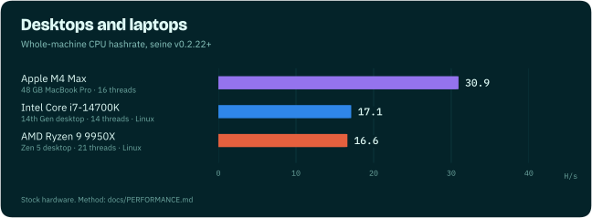

# Performance

Blocknet's proof of work is Argon2id with a 2 GiB arena per hash: it is
memory-hard, so hashrate depends as much on memory bandwidth and latency as on core
count. Seine ships hand-tuned kernels for each instruction set and picks the
fastest one for your machine while it mines.

These are measured results on the stated hardware and settings.
Live mining and offline benchmarks have different measurement scopes, noted below.
Chart data lives
in [`assets/charts/benchmarks.json`](assets/charts/benchmarks.json).

A thread here is one hashing thread with its own 2 GiB arena, the same number you set
with `--threads` or see as "Threads" on the dashboard.

## AMD EPYC 9355P bare metal, default settings

**97.1 H/s** while mining (median of minutes 2-15; 96.4 H/s averaged over all
15 minutes from a cold start) on a 32-core/64-thread Zen 5 EPYC 9355P with 192 GiB of
RAM on Linux. Seine ran with no tuning flags and an empty data directory and chose
64 threads and transparent huge pages itself. The 97.1 H/s figure is the steady
mining rate; 96.4 H/s includes startup.

## AMD EPYC 9375F bare metal

**85.10 H/s** on a complete 32-core/64-thread Zen 5 Turin socket with 384 GiB across
twelve DDR5-6000 channels on Linux: v0.2.39 with 64 fixed mining threads and 1 GiB
huge pages. Three fresh 120-second runs measured 85.18, 85.14 and 84.97 H/s,
counting every completed hash over the whole run including startup and shutdown.

## AMD EPYC 9554P bare metal

**81.4 H/s** on a complete 64-core/128-thread Zen 4 EPYC 9554P with 384 GiB
of RAM on Linux. Automatic settings selected 128 mining threads and automatic
memory pages. This is completed local hashes divided by elapsed time over a
15-minute live mining session, including startup.

## AMD EPYC 9355P bare metal, fixed settings


**77.07 H/s** on the same 9355P socket with v0.2.39, 64 fixed mining threads and
1 GiB huge pages, 15.8% above the v0.2.24 release on the same machine.

## Cloud servers


| CPU | Generation | Instance | Threads | H/s |
|---|---|---|---:|---:|
| AMD EPYC 9R45 | Zen 5 Turin | m8a.8xlarge | 32 | 50.47 |
| AMD EPYC 9R14 | Zen 4 Genoa | m7a.8xlarge | 32 | 45.30 |
| AMD EPYC 7R13 | Zen 3 Milan | c6a.8xlarge | 16 | 18.09 |
| AMD EPYC 7R32 | Zen 2 Rome | c5a.8xlarge | 16 | 17.42 |
| AMD EPYC 7571 | Zen 1 Naples | m5a.8xlarge | 16 | 9.38 |
| Intel Xeon 8488C | Sapphire Rapids | m7i.8xlarge | 32 | 26.00 |
| Intel Xeon 6975P-C | Granite Rapids | m8i.8xlarge | 32 | 24.42 |
| Intel Xeon 8375C | Ice Lake | m6i.8xlarge | 32 | 24.32 |
| Intel Xeon 8259CL | Cascade Lake | m5n.8xlarge | 24 | 15.69 |
| Intel Xeon 8175M | Skylake | m5.8xlarge | 32 | 15.64 |
| Intel Xeon E5-2686 v4 | Broadwell | r4.8xlarge | 32 | 12.95 |
| AWS Graviton4 | Neoverse V2 | m8g.8xlarge | 32 | 39.29 |
| AWS Graviton3 | Neoverse V1 | m7g.8xlarge | 32 | 27.70 |
| AWS Graviton2 | Neoverse N1 | m6g.8xlarge | 30 | 18.63 |

The EPYC 9R45 and 9R14 rows use 32 fixed threads and transparent huge pages.
Their rates measure hashing time; they exclude startup. These are the measured
VM allocations, not whole-socket estimates.

## Desktops and laptops



| Machine | Configuration | H/s |
|---|---|---:|
| Apple M4 Max, 48 GB | 16 threads, `auto` affinity, CPU only | 30.94 |
| Apple M4 Max, 48 GB | 14 threads, `pcore-only` (balanced) | 29.26 |
| AMD Ryzen 9 9950X3D | 16 threads, native Windows, regular pages | 10.31 |

NVIDIA GPUs mine at the same time as the CPU and their rates add up; see the
[NVIDIA guide](guides/nvidia.md).

## NVIDIA RTX 5090 on Windows

**13.8 H/s** steady mining after the miner fee, GPU only, on native Windows 11
with NVIDIA driver 610.88 and 15 automatically selected lanes. Measured on
October 31, 2026 with a public development build. This is a GPU result;
CPU + GPU totals require a separate combined measurement.

## Benchmark your own machine

Offline benchmarks need no daemon or pool:

```bash
# Whole-machine CPU benchmark with default settings
./seine --bench --bench-kind backend --backend cpu --bench-secs 20 --bench-rounds 3

# Compare kernels at a fixed thread count
./seine --bench --bench-kind backend --backend cpu --threads 8 \
  --disable-cpu-autotune-threads --bench-cpu-kernel avx2 --bench-secs 20 --bench-rounds 3
```

`--bench-cpu-kernel` accepts `scalar`, `avx2`, `avx512`, `avx512-256`,
`avx512-256-stream`, `neon` and `neon-sha3`, subject to CPU support.

## Limits

- Cloud results are AWS EC2 guests. A VM exposes a slice of a physical host; memory
  bandwidth share, SMT exposure and topology vary by instance type.
- Desktop results are single machines in a stated configuration. Your RAM speed,
  cooling and background load will move the numbers.
- Huge pages, thread count and CPU placement all change which kernel wins, which is
  why seine measures on your machine instead of hard-coding a choice. See the
  [hardware guides](../README.md#get-the-most-from-your-hardware).
